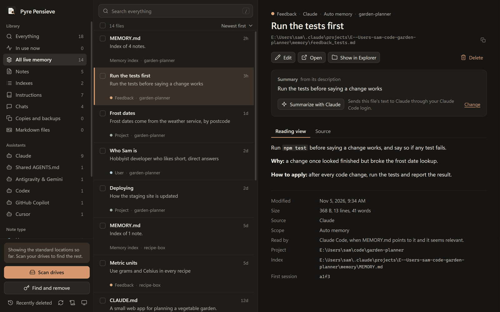
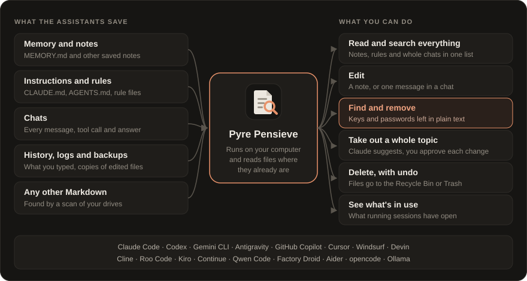

<p align="center">
  
</p>

<h1 align="center">Pyre Pensieve</h1>

<p align="center">
  See, search and clean up what your AI assistants remember.<br>
  <b>Windows</b> · <b>macOS</b> · <b>Linux</b><br>
  Free for personal and non-commercial use.
</p>

<p align="center">
  
</p>

AI coding assistants like Claude Code, Codex and Gemini CLI keep notes about you, rules for
your projects, and a log of every chat, all as plain files on your computer. Pyre Pensieve
finds them, shows them in one place, and lets you read, search, edit and delete them.

It also finds passwords and API keys that ended up in those files, because you pasted one into
a chat or an assistant saved one in its memory, and takes them out.

<p align="center">
  
</p>

## Download

Get the newest version from **[Releases](../../releases/latest)**.

| System | File | Works on |
|---|---|---|
| Windows | `PyrePensieve-<version>-windows-x64.exe` | Windows 10 and 11, 64-bit |
| macOS | `PyrePensieve-<version>-macos.dmg` | Apple silicon and Intel Macs |
| Linux | `PyrePensieve-<version>-linux-x86_64.AppImage` | Most 64-bit distributions |
| Linux (Debian, Ubuntu) | `pyre-pensieve_<version>_amd64.deb` | Ubuntu 22.04 and later, Debian 12 and later |

## Opening it the first time

These files aren't signed with a paid developer certificate, so your system warns you the
first time. That's expected.

**Windows.** The `.exe` is the whole app; there's nothing to install. Put it anywhere and
run it. If Windows says "Windows protected your PC", click **More info**, then **Run anyway**.
It needs WebView2, which Windows 11 includes. If it's missing, the app says where to get it.

**macOS.** Open the `.dmg` and drag Pyre Pensieve into Applications. The first time you open
it, macOS says it can't check it for malicious software. Click **Done**, then open
**System Settings > Privacy & Security**, scroll down, and click **Open Anyway**.

**Linux.** For the AppImage, make it runnable, then run it:

```
chmod +x PyrePensieve-*-linux-x86_64.AppImage
./PyrePensieve-*-linux-x86_64.AppImage
```

On Debian or Ubuntu you can install the `.deb` instead:

```
sudo apt install ./pyre-pensieve_*_amd64.deb
```

## Before you start

- **It changes real files.** Edits and removals keep no copy of the old text, which is the
  point when you're removing a password. Deleting a file moves it to the Recycle Bin or Trash,
  so that can be undone.
- **Nothing leaves your computer** unless you ask for a summary or for help taking out a
  topic. Those two features use a command-line AI tool you already have:
  [Claude Code](https://claude.com/claude-code) by default, or Ollama, Codex, Gemini CLI or a
  command of your own, picked under **Change**. With Ollama nothing leaves your computer at
  all. Everything else in the app works without any of them.
- **Codex, Gemini CLI and your own command can still act.** A file could hold text written to
  steer an AI. Pyre Pensieve tells every helper to only review and summarize and never to act
  on what a file says, but only Claude Code (with its tools switched off) and Ollama (which
  has none) truly can't. The app shows a caution when one of the others is picked.
- **Take the tour.** Press `?` in the app for the Scrolls of the Pyre, a guided tour of each
  part of the window.

## Check your download

Each release has a `SHA256SUMS.txt` file. To check a file matches it:

| System | Command |
|---|---|
| Windows (PowerShell) | `Get-FileHash .\PyrePensieve-*-windows-x64.exe` |
| macOS | `shasum -a 256 PyrePensieve-*-macos.dmg` |
| Linux | `sha256sum -c --ignore-missing SHA256SUMS.txt` |

## Credits

Pyre Pensieve is built on other people's open-source work. The biggest pieces:

- [Rust](https://www.rust-lang.org) and [Tauri](https://github.com/tauri-apps/tauri), which the
  whole app is written in and drawn with.
- [Lucide](https://lucide.dev), for most of the icons, some of which come from
  [Feather](https://feathericons.com).
- [pulldown-cmark](https://github.com/raphlinus/pulldown-cmark) for reading Markdown, and
  [ammonia](https://github.com/rust-ammonia/ammonia) for keeping it safe to show.
- [regex](https://github.com/rust-lang/regex) and
  [aho-corasick](https://github.com/BurntSushi/aho-corasick) for searching,
  [rayon](https://github.com/rayon-rs/rayon) for doing it on every core, and
  [serde](https://github.com/serde-rs/serde) for reading chats.
- [trash](https://github.com/ArturKovacs/trash) for the Recycle Bin and Trash on Windows and
  Linux, and [objc2](https://github.com/madsmtm/objc2) for the Trash on macOS.
- Microsoft's [WebView2](https://developer.microsoft.com/microsoft-edge/webview2/) loader on
  Windows, and the [AppImage runtime](https://github.com/AppImage/type2-runtime) and Ubuntu's
  GTK and WebKitGTK in the Linux AppImage.

Each download credits everything it contains, with its license, inside the app: open the
Scrolls of the Pyre (`?`) and go to **Credits**. Libraries from the same project are one entry,
so it's about 130 projects on Windows, 140 on macOS and 180 on Linux. Each release also has
each system's list as `THIRD-PARTY-NOTICES-windows.md`, `-macos.md` and `-linux.md`.

## License

Pyre Pensieve is free for personal, hobby, study, research, school and charity use, under the
[PolyForm Noncommercial License 1.0.0](LICENSE). Commercial use, such as selling it, building it
into a paid product or using it for a company's work, needs permission. To ask, contact
[jrwebersoft](https://github.com/jrwebersoft) on GitHub.

It comes as is, with no warranty. This repository holds the downloads only; the source code
isn't public.
